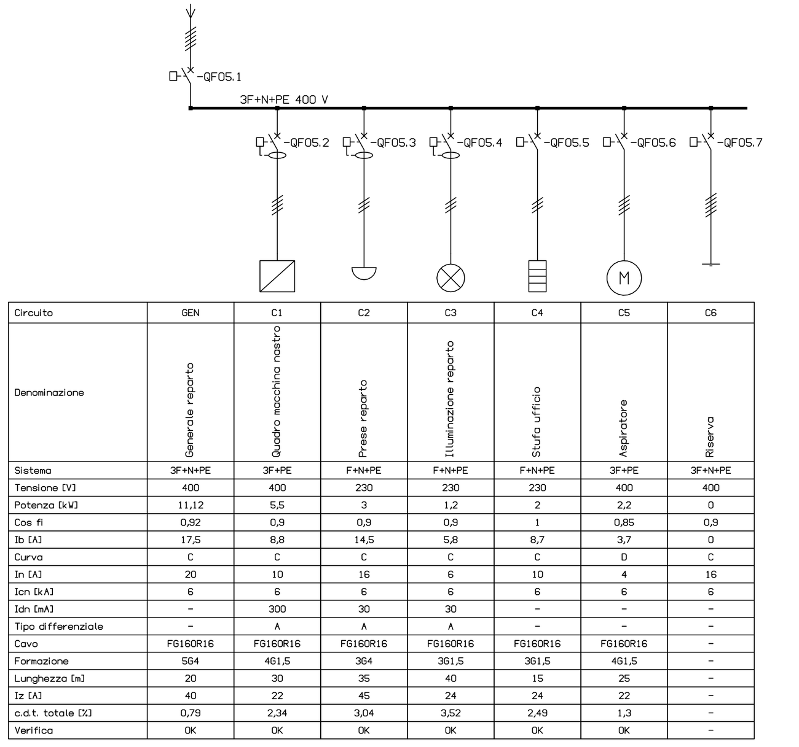

<p align="center"></p>

<h3 align="center">Il CAD elettrico open source per l'automazione industriale.</h3>

<p align="center">
Schemi multifoglio, morsettiere, cavi, PLC, distinte, lay-out del quadro e PDF.<br>
Gratis, leggero, nativo, e pronto per lavorare insieme all'intelligenza artificiale.
</p>

<p align="center">


</p>

<p align="center"></p>

---

## Perché WireCraft

Chi progetta quadri elettrici oggi paga licenze costose, ogni anno, per programmi chiusi, pesanti e legati a una piattaforma CAD di terzi. I progetti restano prigionieri di formati e librerie che non si possono portare altrove.

**WireCraft è l'alternativa libera.** Lo installi, lo usi, lo modifichi, lo integri: senza licenze, senza abbonamenti, senza chiedere il permesso a nessuno.

- ⚡ **Nativo e leggero**: scritto in Rust, parte in un attimo e gira anche su PC modesti.
- 🧭 **Flusso di lavoro professionale**: commesse, multifoglio, siglatura, numerazione fili, cross reference, morsettiere, cavi, PLC, liste. Chi arriva da un CAD elettrico tradizionale si ritrova subito a casa.
- 🔓 **Aperto davvero**: progetti in DXF con i dati elettrici negli attributi, liste in CSV, PDF per tutti. I progetti restano tuoi.
- 🤖 **Pronto per l'AI**: ogni comando ha parametri JSON, quindi script e agenti AI possono disegnare, numerare e verificare uno schema come farebbe un progettista.
- 🔁 **Compatibile**: apre le commesse esistenti in formato `Job-Description._sp` e i loro DWG, con fogli, titoli, rimandi, fili e contatti. Su un progetto reale di 114 rimandi ricalcola tutti i riferimenti incrociati, senza un errore.

## Cosa sa fare

<table>
<tr>
<td width="50%" valign="top">

**📁 Progetti e fogli**
- commesse con l'elenco dei multifogli e i settaggi di commessa
- multifoglio A3 con squadratura 0–9 × A–F e cartiglio compilato da solo
- aggiungi, inserisci, elimina, rinomina, sposta e compatta i fogli: i riferimenti seguono
- titoli e descrizioni di colonna in due lingue
- fogli memorizzati (pagine standard in libreria) e revisioni
- configurazioni con nome per cliente, riusabili nei progetti nuovi

**⚡ Schema**
- fili ortogonali, nodi automatici, alimentazioni e collegamenti a N fili
- rimandi tra fogli con riferimento `foglio/colonnaRiga`
- 52 simboli IEC 60617 disegnati da zero, con anteprime
- inserimento su più fili in un colpo solo (fence); cancella e sposta richiudono i fili
- specchietti dei contatti sotto bobine, relè e salvamotori
- fili colorati come il conduttore vero, dalla tabella delle tensioni (L1 marrone, PE giallo-verde, +24V blu…)

**🏷️ Automatismi**
- siglatura dei componenti in sei modalità, per quadro
- numerazione fili automatica e manuale, fili bloccati, numeri doppi segnalati
- cross reference dinamico con i problemi in rosso, giallo e verde
- navigatore ad albero: quadri, componenti, alimentazioni, rimandi, figli orfani
- vai al collegato: dal contatto alla bobina, dalla bobina ai contatti, tra rimandi
- designazione CEI EN 81346: box di quadro, funzione e ubicazione, etichette sopra la sigla

</td>
<td width="50%" valign="top">

**🔌 Morsetti, connettori, cavi, PLC**
- morsettiere posate con una linea attraverso i fili, con ponticelli a mano o automatici
- editor delle morsettiere: ordine a mano o secondo schema e fili, rinumerazione, morsetti a più livelli, rinomina
- disegno delle morsettiere con i collegamenti interni ed esterni di ogni morsetto, per l'officina
- connettori con pin maschio/femmina
- cavi con le vene posate sui fili e i segnalini
- schede I/O PLC con indirizzi e commenti in due lingue
- configuratore macchina: opzioni che si escludono, progetto generato con le sole opzioni scelte
- loop diagram: per ogni ingresso e uscita il percorso fino al dispositivo in campo

**📋 Liste e uscite**
- sui fogli, sempre aggiornabili: lista fogli, distinta materiali, morsettiere, tabella di cablaggio, lista cavi, lista I/O, legende di funzioni, simboli e revisioni
- tutto anche in CSV ed Excel
- archivio materiali con importazione del listino
- targhette di componenti, fili, morsetti e cavi in CSV per la stampante
- schema d'impianto: i quadri collegati dai loro cavi, con formazione e lunghezza

**🌍 Traduttore**
- dizionario in cinque lingue (IT, EN, DE, FR, ES)
- schema bilingue con un comando: funzioni, titoli, colonne

**🗄️ Quadro**
- layout del quadro: piastra in scala con canaline, guide DIN e ingombri dei componenti presi dallo schema
- gestore topografico: componenti posati e da posare, posa uno per uno, lay-out che segue le sigle dello schema
- foratura della piastra con le quote, in CSV
- pulsantiera sulla porta: pulsanti, emergenze, selettori e lampade dello schema in file, con la foratura
- calcolo termico: temperatura interna, ventilatore o condizionatore che servono, anticondensa
- schema unifilare dei quadri di distribuzione: un circuito per colonna con la sua tabella, protezioni e cavi dimensionati e verificati

**🖨️ Stampa**
- PDF dinamico: segnalibri dei fogli e riferimenti cliccabili
- fili a colori e tutto il resto in nero, come una stampa da consegnare

</td>
</tr>
</table>

### Il lay-out del quadro nasce dallo schema

I componenti del quadro e le morsettiere finiscono sulle guide DIN in scala, tra le canaline. La piastra si sceglie da sola tra le misure commerciali, e la foratura esce con le quote.

<p align="center"></p>

### Il quadro di distribuzione si dimensiona da solo

Scegli l'utenza, la potenza e la lunghezza della linea: WireCraft calcola la corrente d'impiego e propone la taratura della protezione e la sezione del cavo. Poi verifica il coordinamento Ib ≤ In ≤ Iz, la caduta di tensione dall'origine e il potere di interruzione. L'arrivo linea somma le partenze con il coefficiente di contemporaneità. Cambi un dato e tutta la colonna si aggiorna.

<p align="center"></p>

### Le uscite sono già pronte da consegnare

Schema con i fili colorati come i conduttori, calcolo termico del quadro, loop diagram e tabella di cablaggio: generati dal progetto, bilingui, nel PDF con i rimandi cliccabili.

<p align="center"></p>

## Come provarlo

### 📦 Per chi vuole provarlo subito (nessuna installazione necessaria)

Non serve installare Rust né compilare nulla. Su Windows a 64 bit:

1. Vai nella sezione **[Releases](https://github.com/edo023/WireCraft/releases)** del progetto.
2. Scarica il file **`wirecraft-windows-x64.zip`** dell'ultima versione.
3. Estrai l'archivio ZIP sul tuo computer (tasto destro sul file scaricato → *Estrai tutto*).
4. Fai doppio clic su **`wirecraft.exe`**. Il programma parte subito, senza installazioni.
5. Nella finestra *Gestione Progetti* premi **Progetto d'esempio**: si apre un progetto completo da sfogliare e modificare.

---

### 🛠️ Per sviluppatori (compilazione dai sorgenti)

Se vuoi modificare il codice o contribuire al progetto, servono [Rust](https://rustup.rs) 1.95+ e i Build Tools di Visual Studio (C++):

```sh
git clone --recurse-submodules https://github.com/edo023/WireCraft.git
cd WireCraft
scripts/aggiorna-cadcraft.sh          # prepara il motore CAD con i ganci di WireCraft
cargo run --release -p wirecraft      # avvia il programma
```

Vuoi vedere subito un progetto completo? Questo comando genera un impianto di esempio da 22 fogli (alimentazione, motore, ausiliari, PLC, quadro di distribuzione in unifilare, lay-out del quadro, calcolo termico, pulsantiera, disegno delle morsettiere, schema d'impianto, loop diagram, liste e legende) e lo stampa in PDF:

```sh
cargo run --release -p elettrico --example esempio_completo -- esempio.dxf esempio.pdf
```

> Su Windows conviene compilare fuori da OneDrive: `CARGO_TARGET_DIR=C:/dev/wirecraft-target`.

Tutti i comandi, con i parametri, sono nella [guida ai comandi](docs/COMANDI.md).

## Roadmap

Dall'idea alla prima versione pubblica in cinque giorni. La storia completa, giorno per giorno, è nel [CHANGELOG](CHANGELOG.md).

| Quando | Traguardo | |
|---|---|---|
| 23 ottobre 2026 | L'idea: un CAD elettrico libero, con il flusso di lavoro dei programmi professionali | ✅ |
| 24 ottobre | Scelta del motore CAD e prova di fattibilità: blocchi con attributi, estrazione dati, DXF | ✅ |
| 25 ottobre | Modello dati e compatibilità con le commesse esistenti | ✅ |
| 26 ottobre | **Prima versione**: progetti, multifoglio, fili, simboli, siglatura, numerazione, morsetti, cavi, PLC, liste, PDF | ✅ |
| 26 ottobre | Navigatore, Cross Reference, modifica di fili, morsetti e rimandi | ✅ |
| 27 ottobre | Traduttore, lay-out del quadro, foratura piastra, connettori. **Pubblicazione open source** | ✅ |
| 27 ottobre (sera) | Vai al Collegato, configurazioni con nome per cliente, box e designazioni CEI EN 81346, calcolo termico del quadro, loop diagram, tensioni e fili colorati, targhette, ponticelli, liste in Excel, configuratore macchina, pulsantiera; lettura migliore dei DWG di altri programmi | ✅ |
| 28 ottobre | Schema unifilare dei quadri di distribuzione, con dimensionamento e verifica di protezioni e cavi | ✅ |
| 28 ottobre | **Prima release**: [WireCraft 0.2.0](https://github.com/edo023/WireCraft/releases/tag/v0.2.0), l'eseguibile per Windows pronto da scaricare | ✅ |
| 28 ottobre | Editor e disegno delle morsettiere, gestore topografico del quadro; progetto d'esempio dall'app; test di salvataggio e riapertura e di robustezza di tutti i comandi | ✅ |
| 29 ottobre | Schema d'impianto generato dai quadri e dai cavi | ✅ |
| Prossimi passi | Planimetria dell'impianto | 🔜 |
| | Installer per Windows | 🔜 |

## Com'è fatto

WireCraft è un livello elettrico sopra [CADCraft](https://github.com/storytold/cadcraft), un CAD 2D/3D open source in Rust (MIT/Apache-2.0) con comandi in stile classico, blocchi con attributi e file DXF/DWG. WireCraft non lo modifica: lo include come submodule e aggiunge i suoi comandi dall'esterno, così ogni miglioramento di CADCraft arriva anche qui.

| Cartella | Contenuto |
|---|---|
| `apps/wirecraft` | il programma desktop (`wirecraft.exe`): barra a schede, pannelli, finestre |
| `crates/elettrico` | tutti i comandi elettrici, con 62 test di integrazione in `tests/integrazione` |
| `crates/elettrico/examples` | `esempio_completo` (un progetto con tutte le funzioni), `multifoglio`, `analizza` (blocchi e attributi di un DWG) |
| `vendor/cadcraft` | CADCraft, come git submodule |
| `patches/cadcraft` | i piccoli ganci che servono a CADCraft (comandi e menu di un'applicazione) e la versione su cui si applicano |
| `scripts/aggiorna-cadcraft.sh` | prepara CADCraft dopo un clone, o lo porta all'ultima versione (`--ultima`) |

## Contribuire

WireCraft è nato per essere costruito da chi lo usa: progettisti elettrici, quadristi, integratori, sviluppatori.

- **Prova il programma** e apri una issue con quello che manca o non funziona.
- **Simboli e librerie**: nuovi simboli IEC, cartigli, fogli memorizzati.
- **Codice**: ogni funzione nuova arriva con il suo test in `crates/elettrico/tests/integrazione`.

## Licenza e note legali

WireCraft è distribuito, a tua scelta, con licenza [MIT](LICENSE-MIT) o [Apache-2.0](LICENSE-APACHE), come CADCraft.

### Note legali, marchi e interoperabilità

- **Progetto indipendente**: WireCraft è un software open source originale. Non è sponsorizzato, approvato né collegato in alcun modo a produttori di software CAD commerciali.
- **Marchi**: i marchi e i nomi di prodotto di terzi appartengono ai rispettivi titolari. WireCraft non li usa nel proprio nome, nella grafica né nella promozione.
- **Interoperabilità**: WireCraft legge e scrive file DWG/DXF, attributi dei blocchi e file di configurazione di uso comune nei CAD elettrici, solo perché chi lo usa possa aprire e portare con sé i propri progetti. Nessun programma di terzi è stato decompilato: il formato dei file di dati non è tutelato dal diritto d'autore (Corte di giustizia UE, causa C-406/10).
- **Originalità**: codice, interfaccia, testi e libreria dei simboli sono originali; i simboli seguono la IEC 60617 e le designazioni la CEI EN 81346. Il repository non contiene file, blocchi, librerie o documentazione di terzi.

